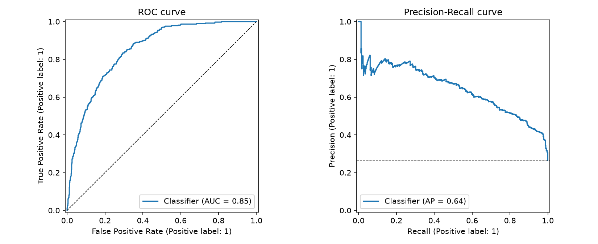
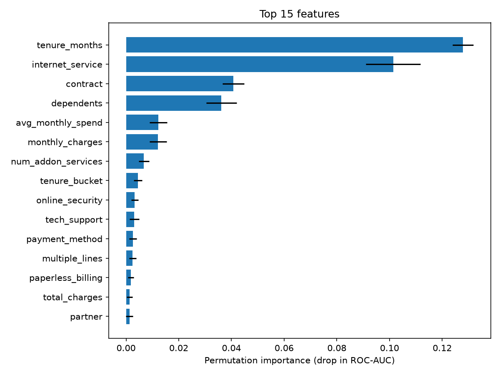

# Customer Churn Prediction

[](https://github.com/mohit6603/Customer-Churn-Prediction/actions/workflows/ci.yml)


An end-to-end, production-style machine learning project that predicts which
telecom customers are likely to churn, so a retention team can intervene
*before* they leave. It covers the full lifecycle: leakage-safe training,
a validated REST API, prediction logging, drift monitoring, experiment
tracking, model versioning, CI and Docker.

**Model:** tuned logistic regression · **test ROC-AUC 0.849** · catches
**91.7% of churners** at the business-tuned decision threshold.

---

## Contents

1. [Business problem](#business-problem)
2. [Quickstart](#quickstart)
3. [How it works](#how-it-works)
4. [Results](#results)
5. [Using the API](#using-the-api)
6. [MLOps](#mlops)
7. [Project structure](#project-structure)
8. [Key design decisions](#key-design-decisions)
9. [Testing](#testing)
10. [Troubleshooting](#troubleshooting)

---

## Business problem

Acquiring a telecom customer costs 5–7× more than retaining one. The model
scores every customer and hands the retention team a **ranked list of
at-risk customers with a recommended action**. It uses only information
available **before** a customer decides to leave.

A missed churner (lost lifetime value) costs far more than a wasted
retention offer (a small discount), so the decision threshold is
deliberately tuned to favour **recall**.

| Risk band | Churn probability | Recommended action |
|---|---|---|
| 🔴 High | ≥ 60% | Immediate retention call: contract upgrade or targeted discount |
| 🟡 Medium | 30–60% | Proactive check-in or service add-on offer |
| 🟢 Low | < 30% | No action needed |

**Dataset:** [IBM Telco Customer Churn](https://www.kaggle.com/datasets/yeanzc/telco-customer-churn-ibm-dataset)
(33-column Excel version): 7,043 customers with a 26.5% churn rate. The data
is gitignored, so download it and place it at `data/raw/Telco_customer_churn.xlsx`.

---

## Quickstart

```bash
# 1. Clone and install
git clone https://github.com/mohit6603/Customer-Churn-Prediction.git
cd Customer-Churn-Prediction
python -m venv .venv && source .venv/bin/activate
pip install -r requirements.txt
brew install libomp                      # macOS only: OpenMP runtime for XGBoost

# 2. Train (needs data/raw/Telco_customer_churn.xlsx)
python -m src.train_pipeline             # ~2 min: validate → train → evaluate → version

# 3. Serve and try it
uvicorn api.main:app --reload            # open http://127.0.0.1:8000/docs
curl -X POST http://127.0.0.1:8000/predict \
     -H "Content-Type: application/json" -d @examples/customer.json
```

Every command is also a `make` target:

| Command | What it does |
|---|---|
| `make train` | Retrain, version, register and log the model to MLflow |
| `make api` | Serve the REST API at http://127.0.0.1:8000/docs |
| `make app` | Launch the Streamlit UI |
| `make test` / `make lint` | Run pytest / ruff |
| `make drift FILE=new.csv` | Check a new customer file for data drift |
| `make mlflow` | Browse experiment runs at http://127.0.0.1:5000 |
| `make docker` | Build and run the API container |

---

## How it works

```
                        ┌────────────────────── python -m src.train_pipeline ──────────────────────┐
 data/raw/*.xlsx ──►    │ validate ─► clean ─► engineer ─► split ─► compare ─► tune ─► threshold ─► │ ──► model + reports
                        │ (schema)   (leakage) (features)  (80/20)  (5-fold CV) (random  (F2, out-   │
                        │                                                       search)  of-fold)   │
                        └───────────────────────────────────────────────────────────────────────────┘
```

| Stage | Module | Key idea |
|---|---|---|
| Load | `src/data_loader.py` | Read the raw Excel export |
| Validate | `src/data_validation.py` | Enforce the 33-column schema and fail loudly on upstream changes |
| Clean | `src/preprocessing.py` | Drop leakage, ID and constant columns. Fix blank `Total Charges` (tenure-0 customers) |
| Engineer | `src/feature_engineering.py` | `num_addon_services`, `avg_monthly_spend`, `charge_growth`, `tenure_bucket` |
| Compare | `src/model_training.py` | Logistic regression vs. random forest vs. XGBoost under identical CV |
| Tune | `src/model_training.py` | Randomized hyperparameter search on the winning model |
| Evaluate | `src/evaluation.py` | Threshold tuning, test metrics, ROC/PR plots, permutation importance |
| Serve | `src/inference.py`, `api/` | Replays the *same* cleaning and feature code at prediction time, so there is no train/serve skew |
| Monitor | `src/monitoring.py` | Prediction log and PSI drift detection |
| Track | `src/tracking.py` | MLflow runs and the versioned model registry |

The five notebooks in `notebooks/` walk through the same stages step by step.
They only call functions from `src/`, so notebooks and production never
diverge.

---

## Results

Model families compared under identical 5-fold stratified CV. Whole pipelines
are cross-validated as a unit, so encoding and scaling are re-fitted per fold:

| Model | CV ROC-AUC |
|---|---|
| **Logistic regression** (tuned C≈2.64) | **0.859** |
| Random forest | 0.846 |
| XGBoost | 0.840 |

Held-out test set (n=1,409), tuned model:

| Metric | @ default 0.50 | @ tuned 0.29 |
|---|---|---|
| Recall (churners caught) | 79.1% | **91.7%** |
| Precision | 51.8% | 43.4% |
| F2 | 0.716 | **0.750** |
| ROC-AUC | 0.849 | 0.849 |

The threshold (0.29) was chosen to maximise F2 on **out-of-fold training
predictions**, never on the test set. The top churn drivers are tenure,
internet service type and contract type.




---

## Using the API

Start the server with `uvicorn api.main:app --reload`, then open
**http://127.0.0.1:8000/docs** for interactive Swagger docs, where you can
try every endpoint from the browser.

| Method | Path | Purpose |
|---|---|---|
| GET | `/health` | Liveness check and loaded model version |
| GET | `/model/info` | Metrics, threshold and input contract |
| POST | `/predict` | Score one customer (JSON) |
| POST | `/predict/batch?top_n=50` | Score a CSV upload, highest risk first |
| GET | `/monitoring/stats` | Volume, flagged rate and risk-band mix of served predictions |
| GET | `/monitoring/drift` | Drift report for recent traffic (needs ≥ 30 predictions) |

**Score one customer** ([`examples/customer.json`](examples/customer.json)):

```bash
curl -X POST http://127.0.0.1:8000/predict \
     -H "Content-Type: application/json" -d @examples/customer.json
```

```json
{
  "customer_id": "DEMO-0001",
  "churn_probability": 0.9434,
  "churn_prediction": 1,
  "risk_band": "High",
  "recommended_action": "Immediate retention call: offer a contract upgrade or targeted discount.",
  "threshold": 0.29,
  "model_version": "v20260731T040705"
}
```

**Score a file** ([`examples/sample_customers.csv`](examples/sample_customers.csv)):

```bash
curl -X POST "http://127.0.0.1:8000/predict/batch?top_n=5" \
     -F "file=@examples/sample_customers.csv"
```

Invalid input is rejected before it reaches the model. For example,
`"contract": "Month to month"` (missing hyphens) returns **422** with a
message listing the allowed values, instead of being silently scored as an
unseen category.

**Streamlit UI:** `streamlit run app/streamlit_app.py` offers a form for
one customer and a CSV upload for batch scoring with a downloadable ranked list.

---

## MLOps

The model doesn't stop at a notebook. It is versioned, served, logged and
watched for drift:

```
 train_pipeline ──► models/churn_model_<version>.joblib   (immutable, versioned)
      │         ├─► reports/model_registry.csv           (every version + metrics)
      │         ├─► reports/reference_profile.json       (training distributions)
      │         └─► MLflow (mlflow.db)                   (params, metrics, plots)
      ▼
 FastAPI ──► /predict, /predict/batch ──► logs/predictions.db (every prediction)
      │                                              │
      └──── /monitoring/stats, /monitoring/drift ◄───┘   PSI vs. training data
```

| Concern | How it's handled |
|---|---|
| **Serving** | FastAPI with Pydantic validation. Each response includes the risk band, a recommended action and the model version. |
| **Experiment tracking** | Every training run is logged to MLflow, so runs can be compared side by side with `make mlflow`. |
| **Model versioning** | Each run saves `models/churn_model_<version>.joblib` and adds a row to `reports/model_registry.csv`. `churn_model.joblib` is always the latest version, so rolling back means copying a file. |
| **Prediction logging** | Every API prediction (inputs, score, model version, timestamp) is written to SQLite for auditing. |
| **Drift detection** | The Population Stability Index compares each feature in recent traffic with its training distribution: < 0.1 stable, 0.1–0.25 moderate, > 0.25 significant (retraining recommended). |
| **CI** | GitHub Actions runs ruff and pytest, then builds the Docker image on every push and pull request. |
| **Containerisation** | A slim, non-root Docker image with a health check and only the runtime dependencies (`requirements-api.txt`). |

**Check a new file for drift** (after training, which creates the reference profile):

```bash
python -m src.monitoring examples/sample_customers.csv
```

**Run in Docker** (after training, so `models/churn_model.joblib` exists):

```bash
docker build -t churn-api .
docker run -p 8000:8000 -v "$(pwd)/logs:/app/logs" churn-api
```

---

## Project structure

```
├── .github/workflows/ci.yml   CI: lint → test → Docker build
├── api/
│   ├── main.py                FastAPI app: endpoints, request logging
│   └── schemas.py             Pydantic request/response contracts
├── app/streamlit_app.py       Streamlit UI (single + batch scoring)
├── configs/config.yaml        All paths, column contracts and hyperparameters
├── data/raw|processed/        Raw export and train/test splits (gitignored)
├── examples/                  Synthetic inputs for trying the API
├── logs/                      Pipeline/API logs and prediction DB (gitignored)
├── models/                    Latest + versioned model artifacts (gitignored)
├── notebooks/                 01 data understanding → 05 evaluation
├── reports/                   Metrics, plots, registry, interview prep
├── src/                       All reusable logic (table below)
├── tests/                     Pytest suite on synthetic data
├── Dockerfile                 API container
├── Makefile                   Shortcuts for every common command
├── pyproject.toml             Ruff + pytest configuration
├── requirements.txt           Full dev environment
└── requirements-api.txt       Minimal runtime deps for the container
```

`src/` modules, one responsibility each:

| Module | Responsibility |
|---|---|
| `data_loader.py` | Load the raw Excel export |
| `data_validation.py` | 33-column schema contract that fails loudly on drift |
| `preprocessing.py` | Stateless cleaning + stratified train/test split |
| `feature_engineering.py` | Engineered features + fitted ColumnTransformer |
| `model_training.py` | Candidate models, CV comparison, randomized tuning |
| `evaluation.py` | Threshold tuning, test metrics, plots, permutation importance |
| `inference.py` | Artifact loading, single/batch scoring with risk bands |
| `monitoring.py` | PSI data-drift detection + SQLite prediction log |
| `tracking.py` | MLflow experiment tracking + versioned model registry |
| `train_pipeline.py` | One-command end-to-end orchestration |
| `utils.py` | Project paths, config loading, logging |

Reports worth opening first: [`reports/metrics.json`](reports/metrics.json),
[`reports/model_comparison.csv`](reports/model_comparison.csv),
[`reports/feature_importance.csv`](reports/feature_importance.csv) and
[`reports/interview_prep.md`](reports/interview_prep.md).

---

## Key design decisions

1. **Data leakage is handled first, not last.** `Churn Score` (IBM's own model
   output), `Churn Reason` (only known after churn), `Churn Label` (target
   duplicate) and `CLTV` are dropped before any modelling. This is the
   difference between a portfolio project and a production incident.
2. **Stateless and fitted transforms are separated.** Row-wise cleaning and
   engineered features are pure functions reused verbatim at inference.
   Anything fitted (scaling, one-hot encoding) lives inside the sklearn
   Pipeline, so CV re-fits it per fold.
3. **Class imbalance is handled with cost weighting**, not resampling. It's
   simpler, leakage-free, and equally effective for these model families.
4. **The threshold is a business decision.** 0.29 trades precision for recall
   because the costs are asymmetric. Both operating points are reported.
5. **The simplest model won.** Logistic regression beat gradient boosting on
   clean, mostly-linear tabular data, and it is interpretable for free.
6. **Validate at the edge.** The API rejects malformed input with a 422,
   and the training pipeline rejects a changed schema. Bad data never
   reaches the model silently.
7. **Every prediction is traceable.** Each response and log row carries the
   model version, so any score can be traced back to the exact model, its
   metrics and its training run.

See [reports/interview_prep.md](reports/interview_prep.md) for a phase-by-phase
Q&A covering every decision above.

---

## Testing

```bash
python -m pytest -q      # 49 tests, ~3 s
ruff check .
```

The suite runs on a small synthetic dataset in the raw 33-column schema
(`tests/conftest.py`), so it never needs the real data or the trained model.

| File | Covers |
|---|---|
| `test_data_validation.py` | Empty data, duplicate IDs, invalid/missing target, label mismatch |
| `test_preprocessing.py` | Leakage removal, `Total Charges` fix, inference payloads, stratified split |
| `test_feature_engineering.py` | Engineered features, feature lists, preprocessor output |
| `test_inference.py` | Batch/single scoring, ranking, risk bands, versions |
| `test_monitoring.py` | PSI maths, drift on shifted data, prediction log |
| `test_tracking.py` | Model versioning, registry, MLflow logging |
| `test_api.py` | Every endpoint, input validation, logging, drift |

---

## Troubleshooting

| Problem | Fix |
|---|---|
| `FileNotFoundError: No model artifact` | Run `python -m src.train_pipeline` first |
| `/monitoring/drift` returns 404 | The drift reference is created by training, so retrain once |
| `/monitoring/drift` returns 409 | It needs at least 30 logged predictions. Score a few files first |
| XGBoost fails to import on macOS | `brew install libomp` |
| Imports time out or packages look "broken" | The project is in a cloud-synced folder (OneDrive/iCloud) that offloads files. Keep the folder on the device, or create `.venv` outside the synced folder |
